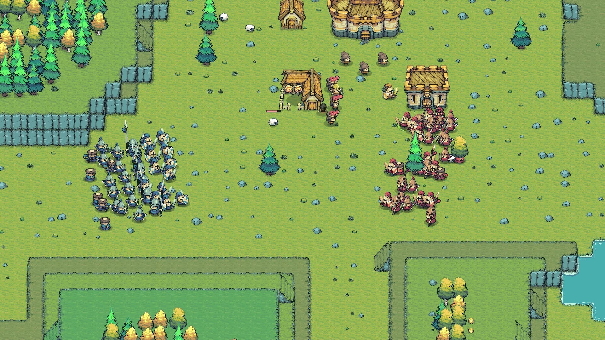
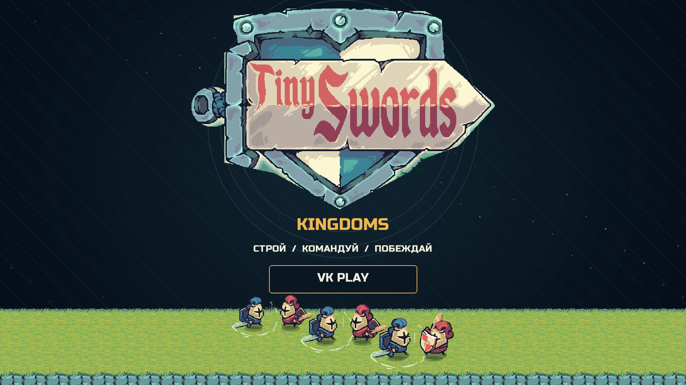
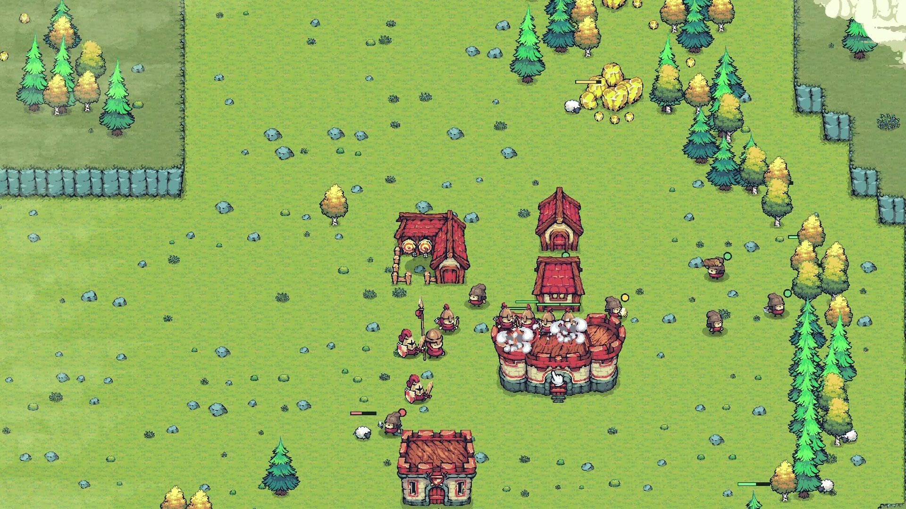
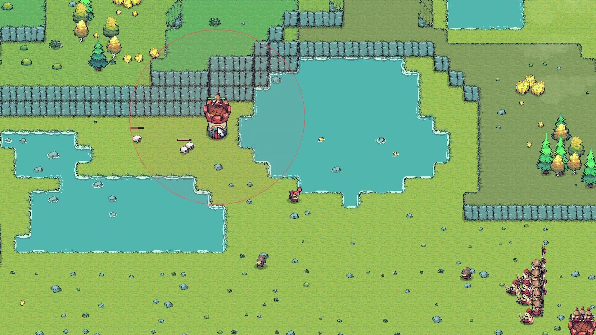
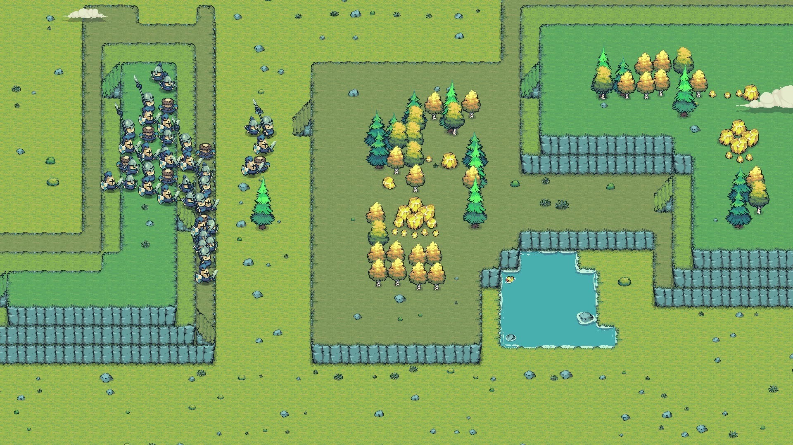
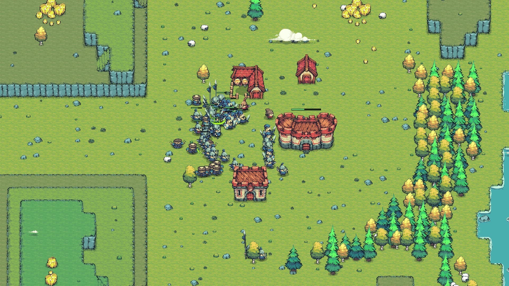

# Tiny Swords: Kingdoms

**Строй. Командуй. Побеждай.**



Моя стратегия в реальном времени на **Godot 4 / GDScript**: от первого поселения и добычи ресурсов до большой армии, союзов и осады вражеского замка. Игра сочетает пиксельную графику, развитие экономики и тактическое управление войсками.

**[Страница игры в VK Play →](https://vkplay.ru/play/game/tinyswords-kingdoms-49863/)** · [Скачать трейлер](https://github.com/Mr-friendly-Spy/TinySwords-Portfolio/raw/refs/heads/main/media/tinyswords-trailer-720p.mp4) · [Посмотреть код](examples/README.md)

Это портфолио проекта: игровые материалы и выбранные фрагменты настоящего кода с пояснениями. Полная игра и её исходный проект здесь не распространяются.

## Об игре

- **Экономика и строительство.** Добыча дерева, золота и еды, развитие поселения, производство войск и оборона.
- **Разведка и тактика.** Процедурные карты, туман войны, управление группами и боевые построения.
- **Дипломатия.** Союзы между королевствами могут менять ход партии.
- **Несколько способов играть.** Кампания, схватки с ИИ, сетевые матчи на 2–4 игроков и кооператив против ИИ.

| Движок | Язык | Жанр | Платформа |
| --- | --- | --- | --- |
| Godot 4 | GDScript | 2D RTS | Windows / VK Play |

## Трейлер и геймплей

[](https://github.com/Mr-friendly-Spy/TinySwords-Portfolio/raw/refs/heads/main/media/tinyswords-trailer-720p.mp4)

**[Скачать трейлер — 81 секунда, MP4, 720p](https://github.com/Mr-friendly-Spy/TinySwords-Portfolio/raw/refs/heads/main/media/tinyswords-trailer-720p.mp4)**

Взял готовый русскоязычный трейлер из материалов для VK Play. Для этого репозитория уменьшены разрешение и размер файла; монтаж и звуковая дорожка сохранены по содержанию. Основная часть показывает запись игрового процесса. Вступление и финальная анимация — оформление трейлера.

Также доступно **[короткое игровое превью из оформления VK Play — 9 секунд, WEBM](media/gameplay-preview.webm)**. Это демонстрационный бой на игровой симуляции, записанный для страницы магазина, без звука.

[gameplay-preview.webm](https://github.com/user-attachments/assets/d8895046-20ff-49f3-8632-ed99bd151675)

## Скриншоты

Кадры из набора галереи VK Play. Изображения перенесены без изменений.

| Развитие королевства | Ландшафт и пути наступления |
| --- | --- |
|  |  |
| **Сбор армии** | **Осада поселения** |
|  |  |

## Примеры кода

Все функции ниже извлечены из реальных файлов игры. Тела функций не переписаны специально для портфолио. В [разборе примеров](examples/README.md) указаны исходные файлы, диапазоны строк и необходимый контекст.

| Пример | Что можно оценить |
| --- | --- |
| [Область нажатия по прозрачности текстуры](examples/ui_click_mask.gd) | Проверки входных данных, работа с `BitMap`, повторное использование вычисленной маски |
| [Измерение текста интерфейса](examples/text_measurement.gd) | Работа с метриками шрифта, переносами строк и размерами элементов Godot |
| [Ограничение повторяющихся звуков](examples/audio_cooldown.gd) | Разделение событий по источнику, пространственная группировка, простой контроль частоты |
| [Непересекающиеся множества](examples/disjoint_sets.gd) | Работа с графовыми компонентами и сжатие путей в union–find |
| [Фрагмент регрессионного теста](examples/README.md#регрессионная-проверка-звука) | Проверка поведения: повтор в одной области подавляется, звук из другой области сохраняется |

Например, поиск представителя множества со сжатием пути:

```gdscript
func _union_find_root(parents: Array[int], component_id: int) -> int:
	var root := component_id
	while parents[root] != root:
		root = parents[root]
	var current := component_id
	while parents[current] != current:
		var next := parents[current]
		parents[current] = root
		current = next
	return root
```

В выборку входят локальные задачи, по которым можно обсудить стиль кода, граничные случаи и инженерные компромиссы. Схема взаимодействия игровых систем, сетевой протокол, логика матча, сцены, сборки и история основного проекта остаются закрытыми. Эти выдержки предназначены для чтения; они не образуют запускаемый Godot-проект.

## Авторство

Разработка игры — [Mr-friendly-Spy](https://github.com/Mr-friendly-Spy). Игровая графика — [Pixel Frog / Tiny Swords](https://pixelfrog-assets.itch.io/tiny-swords).

Происхождение видео и изображения, а также авторы материалов трейлера перечислены в [описании медиаматериалов](media/README.md). Назначение публикации и условия использования — в [NOTICE.md](NOTICE.md).
